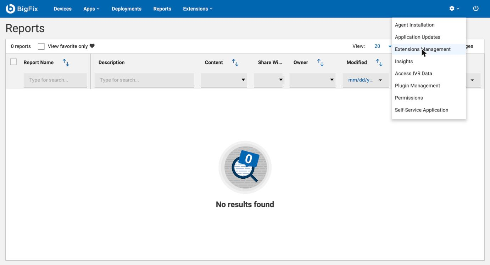
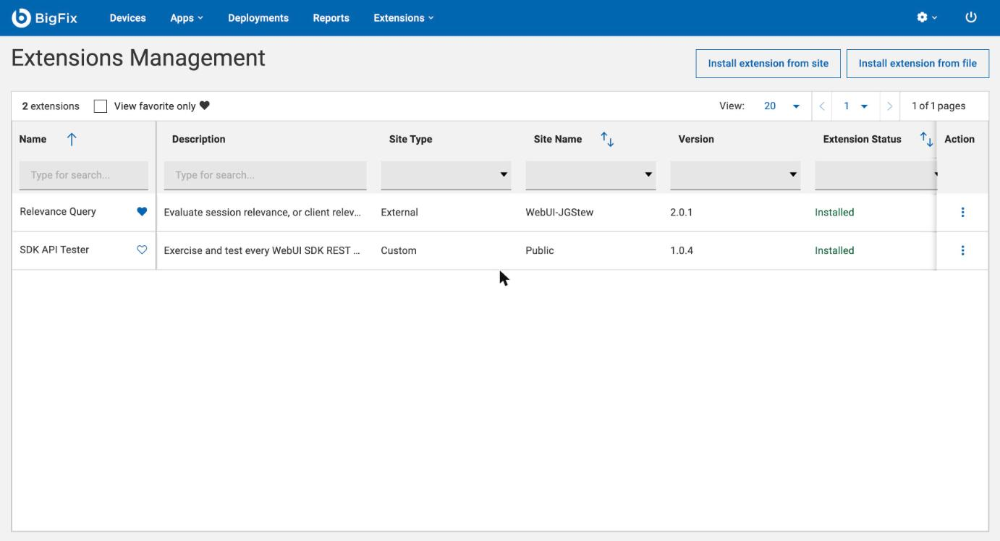
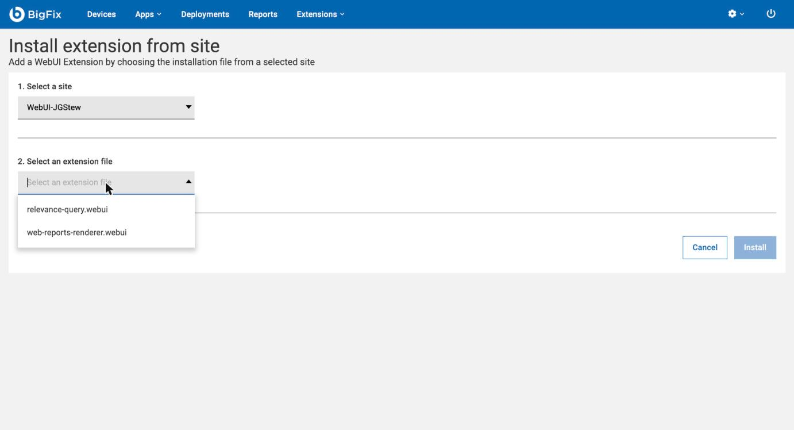
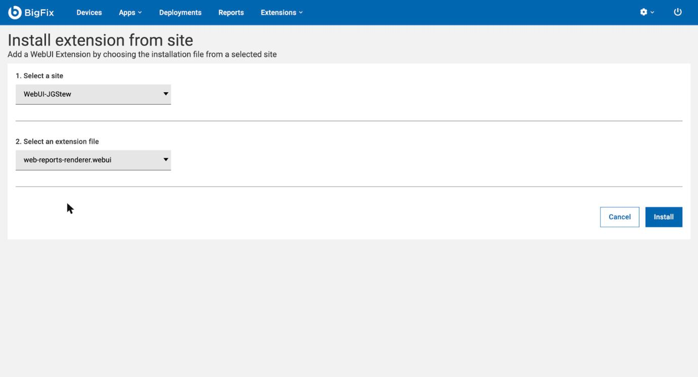
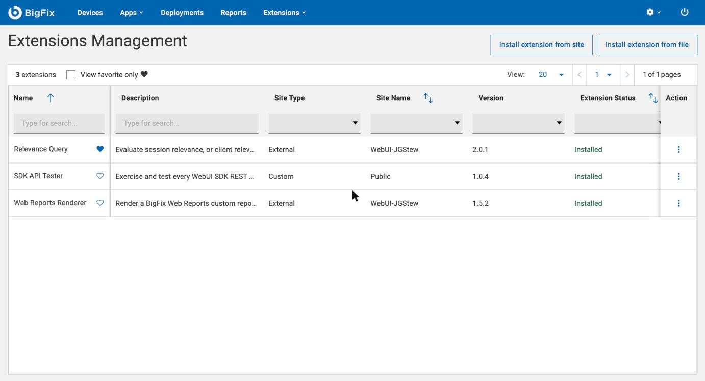
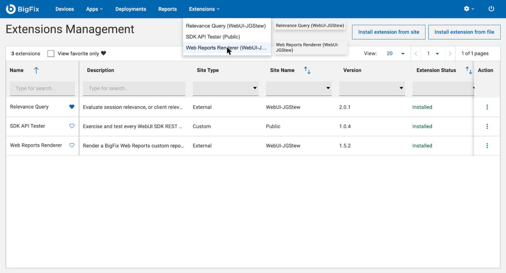
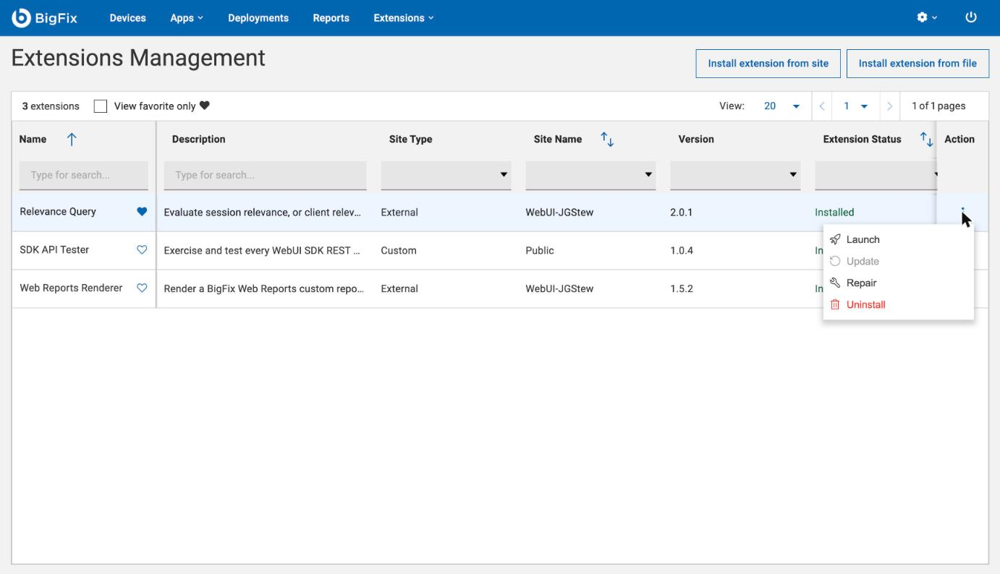
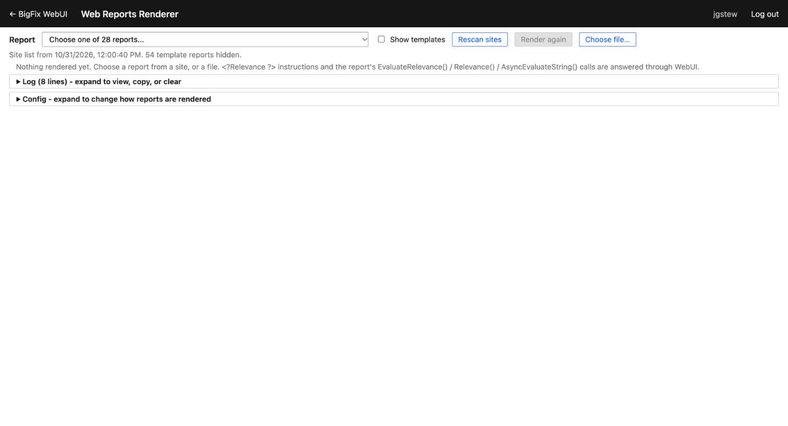
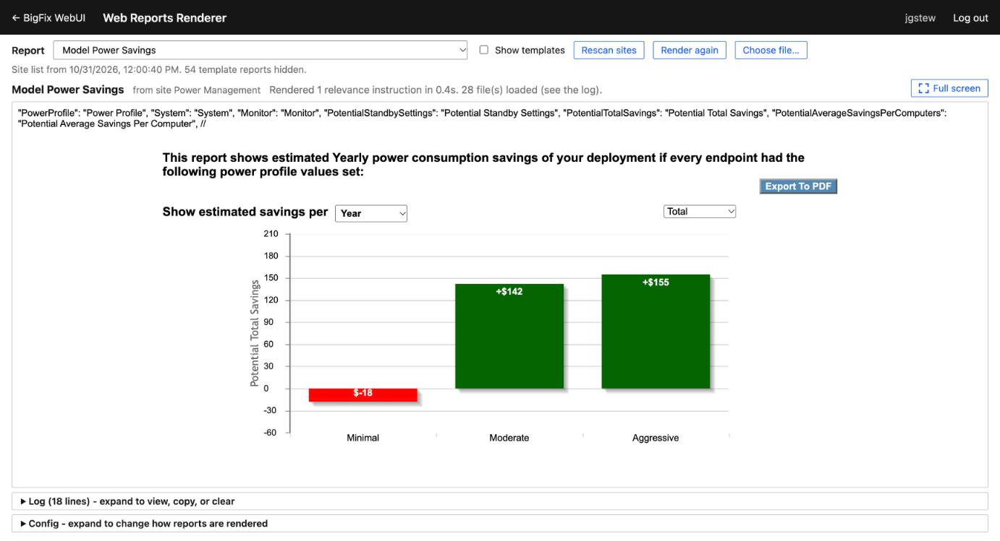
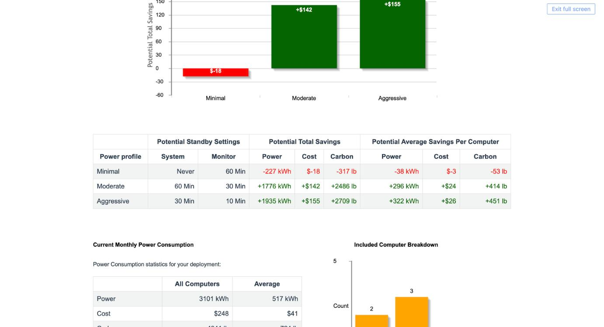

**Web Reports Renderer** is a BigFix WebUI extension that runs your existing Web Reports **custom reports** inside WebUI, with live data. Pick a report from a drop-down of every custom report stored in your BigFix sites, and it renders the way it does in Web Reports: `<?Relevance ?>` instructions are evaluated, the report's own JavaScript relevance calls (`EvaluateRelevance`, `Relevance`, ...) are answered through WebUI, and its scripts and stylesheets load from the same site. No rewriting reports, and no switching to Web Reports to see them.

----------

### Before you start

- **Extensions Management** must be enabled in WebUI: set `_WebUIAppEnv_ENABLE_EXTENSIONS_MANAGEMENT=1` and restart WebUI.
- **The WebUI-JGStew site** must be added on the root server as a repository site from https://github.com/jgstew/bigfix-site-webui-jgstew. That deserves its own walkthrough, so it isn't covered here.
- Listing and loading reports from sites needs the operator permission **Can use REST API**.

### Install it from the site

In WebUI, open the gear menu at the top right and choose **Extensions Management**:

Click **Install extension from site**:

Pick the site **WebUI-JGStew**, then the file **web-reports-renderer.webui**:

Click **Install**:

It shows up as installed from the external site WebUI-JGStew:

Launch it from the **Extensions** menu. It opens in a new tab:

### Upgrading

When the site has a newer version, WebUI doesn't say so: the row still shows the old version as **Installed**, and **Update** is greyed out. Use **Repair** in the row's **Action** menu. Its confirmation only says it will reinstall the extension, but it installs the version that is in the site now:

### Use it

The **Report** drop-down lists the custom reports from all of your sites, grouped by site. The list is cached in a shared dashboard variable, so it shows up right away and only sites that changed get checked again. **Rescan sites** rebuilds it, and **Choose file...** renders a report file instead (or drop one on the page):

Choose a report and it renders below, using most of the window:

**Full screen** gives the report the whole screen; **Esc** or **Exit full screen** goes back:

The collapsed **Log** at the bottom records every relevance evaluation, file and error, and **Copy report** puts it all on the clipboard for troubleshooting.

### Good to know

- Images and fonts from sites don't load, because WebUI's REST passthrough corrupts binary files. Scripts, stylesheets and SVG do, and common library images come from copies bundled in the extension.
- Template reports (saved Web Reports pages) can't be rendered, so they're hidden unless **Show templates** is checked.
